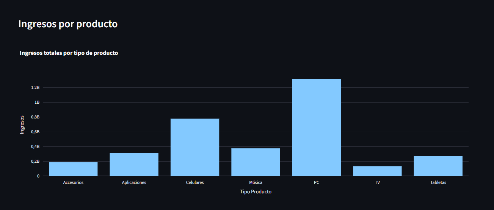
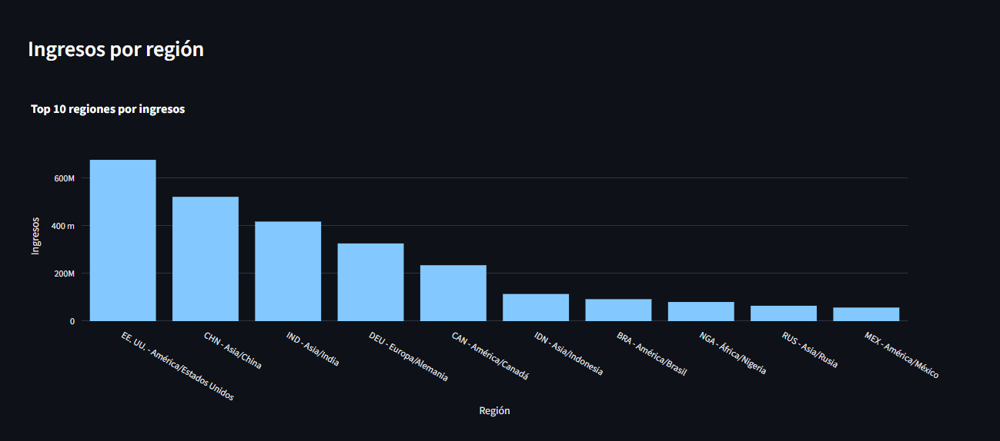

# SmartBI 📊

Plataforma de análisis de datos automático para PYMEs.

## ¿Qué es SmartBI?
SmartBI convierte archivos Excel y CSV en análisis completos: 
KPIs automáticos, gráficos y resúmenes ejecutivos generados 
con IA. Pensado para empresas que no tienen equipo de BI.

## Tecnologías
- Python (Pandas)
- Streamlit
- Plotly
- SQL
- API de IA (OpenAI / Claude)

## Estado del proyecto
🚧 En desarrollo — Fase 1: Motor de datos en Python

## 🔍 Detección de anomalías

SmartBI analiza archivos CSV o Excel y detecta automáticamente los días con ventas fuera de lo habitual.

- Funciona con archivos sencillos de fecha y ventas, y también con datos por región y producto
- Marca los días atípicos en el gráfico (más de 2,5 desviaciones estándar respecto a la media)
- Genera un resumen y alertas ordenadas de más a menos extrema, con la fecha, el valor, la media y una recomendación de revisión

**Ejemplo:** con un año de ventas diarias (365 días), detecta 7 días atípicos. El más extremo es el 28/03/2025, con 20.651,90 de ventas.

> Una anomalía estadística no significa necesariamente un error: indica un dato que conviene revisar.

## 📊 KPIs, gráficos y resumen automático

Con archivos que incluyen región, producto, ingresos y gastos, SmartBI calcula automáticamente:

- KPIs de ingresos y gastos con formato en euros
- Gráficos de ingresos por región (Top 10) y por tipo de producto
- Un resumen en texto con ingresos, gastos, beneficio estimado, margen, región y producto principales
- Alertas de valores atípicos dentro de cada región y producto
- Informe en PDF descargable con el resumen y las alertas

## Autor
Eduardo · Analista de Datos Junior · Madrid

